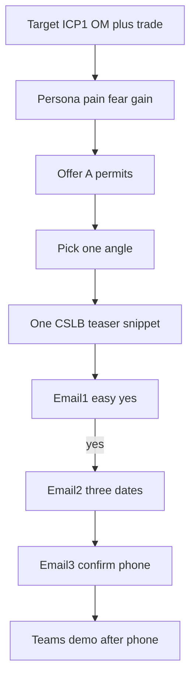

# Codicen — targeting, offers, angles, snippets, scripts

## What Codicen is (so copy has a premise)

**Codicen LLC** (codicen.com) helps **California contractors with an active CSLB license** keep track of renewal dates and get reminded before they are due.

**What they actually do (plain words):**
- Build a calendar of deadlines tied to that contractor’s situation (license, bond, coverage on file, later city / trade items after they share more).
- Text + email reminders **60 / 30 / 7 days** before each deadline.
- They **do not** file renewals, pay bonds, sell coverage, give legal advice, or work for the state.

**Why anyone cares (the premise of every script):**
Most shops think “the letter in the mail + our bond person” is enough. That letter is mainly the **license**. Other dates that can stop permits or pay live elsewhere. Codicen makes those dates visible and reminds the office before they bite.

**Sales path (reconcile onboarding + front-end test):**
- **Cold / Wave 1 front door:** easy **yes** → send a small **public-file date snapshot** → short **phone** walkthrough of those dates (confirm number). No product pitch in email 1–2.
- **After that call:** 30-min **Microsoft Teams** intro/demo (Haroon / Idris, 8am–5pm PDT). Pricing only on call: “We tailor every calendar… depends on licenses, entities, cities and crews.”
- **Never say:** prices, client names/results, guarantees they won’t miss a date, that Codicen files/pays anything, CSLB affiliation, that *their* license/bond/coverage is lapsed or under audit.

Spam / copy SOPs: [05-copy-messaging-framework-agent-5/SOP.md](05-copy-messaging-framework-agent-5/SOP.md), [SOP-spam-guard.md](05-copy-messaging-framework-agent-5/SOP-spam-guard.md).

---

## 1) Targeting (who we mail)

### Must be true
- California only
- Active CSLB contractor (CLEAR / renewable)
- Trade in list below
- Title: **Office Manager first**, then Owner / CEO / qualifier

### Size bands
| Band | Headcount | Who we email | Role |
|------|-----------|--------------|------|
| ICP 1 (Wave 1) | 10–50 | Office Manager → Owner | Control. Crew + office, no compliance team |
| ICP 2 | 5–9 | Owner | Owner still runs the office |
| ICP 3 | 50–100 | Office / Ops Manager | More dates, still no dept |
| Kill-test only | 1–4 | Owner | Cap volume; replies ≠ buyers |

Do **not** mix 1–4 into ICP 1. Do **not** mail 100+, out-of-state, non-contractors, or “fix my suspended license for me.”

### Trade bands (plain words in copy)
| Code | Say in email |
|------|----------------|
| B | general building |
| C-10 | electrical |
| C-36 | plumbing |
| C-20 | HVAC |
| C-39 | roofing |
| C-33 | painting |
| C-8 | concrete |

Dedup on CSLB number. Firmographic only for list build (size, trade, title, entity). **Do not** use expiration as a cold-copy scare opener (onboarding “hot signal” is for ops priority / later waves only).

---

## 2) Persona (who we talk to)

### Primary: Office Manager (ICP 1)
**Job:** keep the office moving while the qualifier is on a job.
**Language:** permits, paperwork, mail, “the bond guy,” “CSLB sent something,” jobs, crews — not “compliance platform.”

**Internal thoughts (messy):**
- “I’ll deal with the mail when it shows up.”
- “The boss is on a job; this can wait.”
- “We already have a system… I think.”
- “If something’s wrong, someone would tell us.”
- “I don’t want another tool. I just don’t want a surprise.”

| | |
|--|--|
| **Pain** | Dates live in mail / someone else’s head; office finds out late |
| **Fear** | Job or permit stops; boss blames the office |
| **Gain** | Know what’s coming without hunting; office has the list while field is busy |

### Secondary: Owner / CEO (ICP 2)
**Job:** keep pulling work and getting paid.
**Fear:** something on paper kills a job or pay.
**Gain:** stay clear to work without babysitting paperwork.

Awareness for Wave 1 cold: mostly Level 1–2. Message = observation + easy yes, not a product demo.

---

## 3) Offers (what we put in their hands)

**Core free front-end offer (same asset, different want):**
Send the **three public dates** for their company: **license, bond, and coverage on file** (never say “comp” in email 1; in email 2 say “coverage on file”).

| Offer | Want (their words) | Who |
|-------|--------------------|-----|
| **A — Permits** (Wave 1 control) | Keep pulling permits | Office Manager |
| **B — Stay able to work / get paid** | Keep jobs and pay moving | Owner |
| **C — Letter isn’t everything** | See what the renewal letter doesn’t show | Office Manager (if “CSLB already mails us”) |
| **E — Office while boss is out** | Office has the dates while qualifier is on site | Office Manager |
| **D — City / EPA / public works** | Keep specialty work | **Not Wave 1 cold** |

**Paid product (only after call):** 12-month calendar + 60/30/7 texts/emails. Never priced in email.

**Wave 1 conversion:** one offer (A), two paths — both end on **confirmed phone + short call**, then Teams demo.
- Method 1: yes → send 3 dates → ~1 day later ask to call
- Method 2: yes → unique link with 3 dates + confirm number (only if links can be pre-built)

---

## 4) Angles (how we say the offer)

One idea per email. Third-grade clear.

1. **Letter hole** — Renewal mail is mostly one piece. Other pieces sit on the public file.
2. **Permit / job outcome** — You need those pieces clear to keep pulling permits / keep work moving.
3. **Office vs field** — When the boss is on a job, the office still needs the dates.
4. **Trade-in-plain-words** — For electricians / plumbers / HVAC / etc. in {{city}}, same three items usually matter.
5. **Soft timing (spam-safe)** — Tie to *their* calendar (“before your next permit pull”), **not** “urgent / expires soon / your license is at risk.”

---

## 5) Custom snippets (relevance without dumping)

### Email 1 — tease only
Use **one** of:
- `{{company_name}}` + `{{city}}` + `{{trade_plain}}`
- `{{principal_first}}` on a job / office holds the mail
- “public file shows a bond on record” (no date, no license #)
- “coverage on file” without dates

**Never in email 1:** license number, full date list, “workers’ comp/comp,” product demo, Teams, price, “at risk / lapsed.”

### Email 2 — magnet (after yes)
- License: `{{license_exp}}`
- Bond (`{{surety_short}}` optional): `{{bond_exp}}`
- Coverage on file: `{{coverage_exp}}`

### Relevance ladder
| Level | Fields | Use |
|-------|--------|-----|
| Base | company, city, trade_plain | Every send |
| Better | principal_first, business_type | Office vs field angle |
| Magnet | license_exp, bond_exp, coverage_exp, surety_short | Email 2 only |
| Later | cities they name | Offer D / full calendar |

---

## 6) Script system

Structure: **their thought → their reality → soft offer → easy CTA.**

**Email 1 CTA (locked):** “Want me to send those three dates?” / “Reply yes and I’ll send them.”
**No call ask in email 1.**

**Email 3 CTA:** confirm `{{phone}}` or better number for ~10–12 min phone walkthrough.

Spam-guard: no Hi/Hey/Hello, no em dashes, no banned tokens.

---

## 7) Deliverable after approval

One internal brief: [docs/codicen-wave1-gtm-brief.md](docs/codicen-wave1-gtm-brief.md) containing:

1. Codicen premise (3–5 sentences, third-grade)
2. Targeting table + do-not-mail
3. Persona sheets (OM + Owner) with monologue / pain / fear / gain
4. Offer + angle cards (A/B/C/E; D parked)
5. Snippet dictionary (email 1 vs 2) + PlusVibe variable map
6. Full scripts: 4× Email 1, Email 2 magnet, Email 3 call bridge, objection one-liners (spam-safe)
7. Inbox handoff: phone first for Wave 1 front door; Teams 30 min for demo; CC Haroon/Idris; never-say list

---

## Premise in one line

**We are not selling “dates.” We are showing a California contractor office that the mail system is incomplete — and offering to send their three public dates so keeping permits and jobs moving is easier — then talking it through on a short call.**
