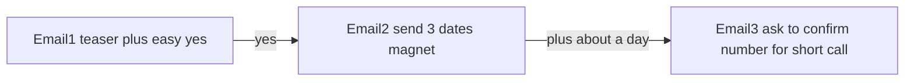

---
todos:
  - id: monologue
    status: completed
    content: Write ICP internal monologue + spam-safe angle map (A/B/C/E)
  - id: email1-variants
    status: completed
    content: 'Draft 4 Email-1 teaser variants (easy yes, no license #, no comp, no call ask)'
  - id: email2-3
    status: completed
    content: Draft Email-2 magnet + Email-3 phone bridge with CSLB→PlusVibe variable map
  - id: spam-scan-doc
    status: completed
    content: Spam-guard scan all copy; write docs/cslb-codicen-wave1-cold-emails.md
name: CSLB teaser cold emails
overview: 'Draft Wave 1 cold-email copy that teasers CSLB-based snippets (no full dates, no license #, no “comp” jargon), spam-guard compliant, outcome-led easy-yes, then magnet → phone call—without fake urgency tokens.'
isProject: false
---
# CSLB teaser cold emails (spam-free)

## Source rules (locked)

- Copy SOP: [`05-copy-messaging-framework-agent-5/SOP.md`](05-copy-messaging-framework-agent-5/SOP.md)
- Spam/deliverability: [`05-copy-messaging-framework-agent-5/SOP-spam-guard.md`](05-copy-messaging-framework-agent-5/SOP-spam-guard.md)
- Offer truth: Codicen doc — free **license + bond + workers’ comp dates** from public CA file; phone call after value; no product/demo in cold copy
- Your constraints: **custom snippets**, **do not dump details in email 1**, **easy yes**, **no license number**, **no “comp”**, less jargon, more relevant, interest/timing without sounding like a pitch

## Spam-guard constraints that shape “urgency”

Banned for copy (among others): `urgent`, `soon`, `now`, `get`, `insurance`, `open`, `free`/`no cost` promo phrases, fake countdown language, `Hi`/`Hey`/`Hello` greetings, em dashes, ALL CAPS.

So we will **not** write “your license is expiring soon / urgent renewal.”  
**Timing interest** = soft calendar curiosity tied to *their* world (next permit pull, mail while the qualifier is on a job, letter isn’t the whole system)—not scare deadlines.

## Email 1 job (one idea)

1. Prove it’s about **their shop** (name + city + trade in plain words).  
2. One **teaser** from CSLB-backed reality (not the full magnet).  
3. Clear outcome in their words (keep pulling permits / keep jobs moving / office isn’t guessing).  
4. CTA = **reply yes** → we send the 3 dates. **No call ask.**

## Snippet strategy (hide most data)

| Keep for backend / email 2 | Tease in email 1 only |
|----------------------------|------------------------|
| Exact license # | Never in email 1 |
| Full date trio | Never in email 1 |
| “Workers’ comp” / “WC” / “comp” | Say **“coverage on file”** or omit label |
| Bond surety + amount | Optional one plain clue: “who holds your bond” |
| Class codes (C-10) | Plain trade: electrician, plumber, HVAC, roofer, painter, concrete, general building |
| Status CLEAR | Silent (only mail CLEAR) |
| Qualifier name | “while {{principal_first}} is on a job” if present |

**Email 1 snippet picker (one per send):**

1. **Letter hole** — renewal mail is mostly the license; two other items sit on the public file.  
2. **Office vs field** — dates still follow the qualifier while they’re on site.  
3. **Permit outcome** — before the next permit pull, worth knowing the three public items in one place.  
4. **Trade line** — for {{trade_plain}} shops in {{city}}, those three usually matter for keeping work moving.  
5. **Bond clue (no date)** — public file shows a bond on record; letter doesn’t spell the whole picture.

## Sequence (Wave 1 Method 1 shape)



- **E1:** observation + teaser + “want me to send the three dates?”  
- **E2:** only after yes — company name + three dates in plain labels (**License / Bond / Coverage on file**), still no call ask.  
- **E3:** “easiest is a short call to walk who owns what — try {{phone}}?”

## Angles / offers mapped to Codicen (plain language)

| Angle | Outcome they feel | Persona |
|-------|-------------------|---------|
| A control | Keep pulling permits | Office manager 10–50 |
| B | Keep jobs / pay moving | Owner |
| C | Letter isn’t the whole system | If they trust the envelope |
| E | Office has the dates while qualifier is out | Office manager |

Wave 1 default: **Angle A**, Office Manager, CA, 10–50, mixed trades. Owner variants use Angle B wording only.

## Deliverable (after you approve this plan)

Write into [`docs/cslb-codicen-wave1-cold-emails.md`](docs/cslb-codicen-wave1-cold-emails.md) (or PlusVibe-ready blocks per [`SOP-plusvibe-templating.md`](05-copy-messaging-framework-agent-5/SOP-plusvibe-templating.md)):

1. Internal monologue (5–8 lines) for office manager / owner  
2. 4 Email-1 variants (A / B / C / E) under ~60–80 words, spam-scanned  
3. Email-2 magnet template (variables only)  
4. Email-3 call bridge  
5. Variable map from CSLB → PlusVibe fields (`company_name`, `city`, `trade_plain`, `principal_first`, `license_exp`, `bond_exp`, `coverage_exp`, `phone`)  
6. Final spam-guard checklist pass on every line

## Sample Email 1 shape (illustrative; final copy in implementation)

```
{{first_name}}

For {{company_name}} in {{city}} ({{trade_plain}}), a lot of offices run on the renewal letter plus the bond person.

That letter is mostly one piece. Two other items on the public file still matter for pulling permits.

Want me to send you those three dates in one note?
```

No license #, no “comp,” no call ask, no banned urgency tokens.

## Out of scope

- Building PlusVibe campaign in-product  
- Enrichment / Treg spend  
- Offer D (city/EPA) on cold list  
- Scare copy about lapses or expiration countdowns
