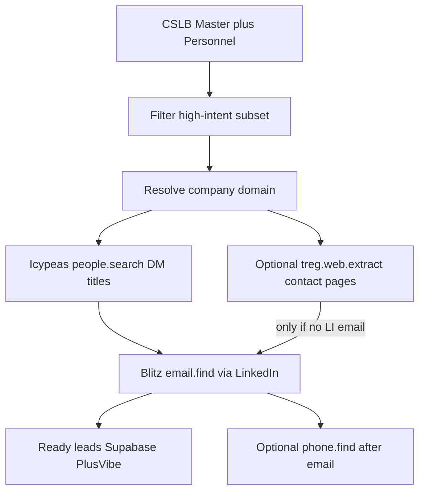

---
todos:
  - id: ingest-script
    status: completed
    content: 'Add scripts/ingest_cslb_master_list.py: download Master + Personnel via ashx, join on LicenseNo, normalize principals/titles, write data/cslb/'
  - id: docs-schema
    status: completed
    content: 'Document CSLB URLs/schema, no-email statute, and Treg DM enrichment waterfall under docs/'
  - id: supabase-upsert
    status: completed
    content: Optional bulk upsert to cslb_licenses (+ principals) when Supabase env is configured
  - id: sales-filters
    status: completed
    content: CLI filters for expiration window / status / classification / BusinessType for outreach slices
  - id: dm-enrich-runner
    status: completed
    content: 'Add scripts/enrich_cslb_decision_makers.py: domain resolve → Icypeas people.search (Owner/Officer titles) → Blitz email.find; gates --scope-only/--estimate/--confirm-spend/--pull; optional web.extract fallback'
  - id: dm-pilot
    status: completed
    content: Pilot Pull-N on a high-intent slice (e.g. expires 30–120d) after free TAM + catalog quote; stop for --confirm-spend
name: CSLB bulk ingest
overview: 'Ingest CSLB’s free statewide Master + Personnel CSVs (~245k licenses), then enrich a filtered subset via Treg: resolve domain → find Owner/Officer decision makers → Blitz work emails (page-crawl only as a fallback).'
isProject: false
---
# CSLB contractors + decision-maker emails (Treg)

## Verdict

1. **Do not ZIP-scrape CSLB.** Official free statewide CSVs already cover ~245k licenses (company, location, classification, license dates/status, company phone, bonds/WC).
2. **CSLB will never give work emails** (B&P Code §27). Decision-maker **emails** require Treg enrichment after ingest.
3. **Best DM source on-file:** CSLB **Personnel** file (Principals with Officer / RMO / RME titles) joined to Master — not page crawling first.
4. **Default email path (locked Cheap Scrape):** domain resolve → `icypeas.people.search` (Owner/President/CEO/Founder/Principal/Partner/Officer) → `blitzapi.people.email.find` with Blitz route headers. **Page crawl is a fallback**, not the primary DM finder.
5. **Company phone** is already on Master (`BusinessPhone`). **Personal/mobile DM phones** are a separate paid step (`treg.people.phone.find` / Blitz phone) — run only if needed after email path works.

## Part A — Free CSLB bulk ingest

| Source | Endpoint | What you get |
|--------|----------|--------------|
| License Master | `DownLoadFile.ashx?fName=MasterLicenseData&type=C` | ~245,633 rows / ~78 MB; company, address, **BusinessPhone**, status, issue/expiration, classifications, bonds/WC |
| Personnel | `DownLoadFile.ashx?fName=PersonnelData&type=C` | Per-license principals: `Name`, `Name-TP`, `EMP-Titl-CDE` (Officer, RMO, RME, …) |
| UI | [Data Portal → MASTER LIST](https://www.cslb.ca.gov/OnlineServices/DataPortal/ContractorList) | Same files; stamped e.g. Updated as of 10/23/2026 |

Portal: https://www.cslb.ca.gov/onlineservices/dataportal/

Ingest joins Master ⟷ Personnel on `LicenseNo` / `LIC-NO`, parses principal names, keeps titles, flags `expires_within_N_days`.

## Part B — Decision makers + emails via Treg

Gap: Master has **no website/domain**. Without a domain (or LinkedIn), Blitz email find is weak. Waterfall:



### Step 0 — Slice first (never enrich all 245k)

Prioritize for licensing-software outbound, e.g.:

- `PrimaryStatus = CLEAR`
- `ExpirationDate` in 30–120 days
- Target classes (B, C10, …) and/or counties
- Prefer Sole Owner / small firms where principal ≈ buyer

Pull-N + `--confirm-spend` gates from [lead-scrape-gates](.cursor/skills/lead-scrape-gates/SKILL.md) still apply.

### Step 1 — Who is the decision maker? (mostly free from CSLB)

From **Personnel** (preferred):

- `Name-TP` ≈ Principal
- `EMP-Titl-CDE` containing Officer, Responsible Managing Officer/Employee, Partner, Owner-like titles

From **Master** when Sole Owner (~114k): business name often is the person; still prefer Personnel name when present.

These names feed name+domain email find and LinkedIn matching.

### Step 2 — Resolve company domain (paid/cheap)

CSLB has no website. Resolve before people search:

| Tool | Role | Cost (catalog) |
|------|------|----------------|
| `hunter.x.domain-finder` | Company name → likely domain | free |
| `crustdata.companies.identify` | Name → ranked company matches | free |
| `treg.companies.enrich` / `blitzapi.companies.enrich` | Name or domain → website + firmographics | ~$0.000495/success |
| `treg.companies.search` | Broader company discovery | routed / often free search |

Validate domain against city/state when possible (contractors are noisy names).

### Step 3 — Find DM people (Cheap Scrape default)

**Locked primary:** `icypeas.people.search.count` (free TAM) → `icypeas.people.search` (~$0.00038/row)

Query shape:

- `currentCompanyWebsite.include` = resolved domain **or** `currentCompanyName.include` = BusinessName (domain preferred)
- `currentJobTitle.include` = Owner, President, CEO, Founder, Principal, Partner, Managing Member, Officer (tighten per ICP)
- Strong `currentJobTitle.exclude` (Sales, Marketing, Intern, …) **in-query**
- Geo: CA / profileLocation as needed
- `pagination.size` small for pilots

Alternatives (not default for volume):

- `blitzapi.people.employee-finder` — needs LinkedIn company URL; ~$0.000495/result
- `contactout.people.decision-makers` — ~$0.02/result before reveal (~$0.67) — too expensive as default
- Free discovery (`apollo` / `quickenrich` / `leadsforge` search) only as experimental; email still goes through Blitz path after LinkedIn is known

### Step 4 — Work email (required goal)

**Locked:** `blitzapi.people.email.find` (~$0.000495/success) with LinkedIn URL.

Headers:

```
X-Treg-Route-Max-Cost: 0.01
X-Treg-Route-Waterfall: 0
X-Treg-Route-Exclude: aiark,icypeas
```

When you have **Personnel full name + domain** but no LinkedIn yet: try Icypeas name+company first to get LI, then Blitz. Name+domain finders (e.g. `trykitt.people.email.find` ~$0.005/success) are opt-in only — not the default Cheap Scrape path.

Verify before send (`millionverifier` / `treg.people.email.verify`) after the path is proven — not on the first pilot burn.

### Step 5 — Page crawl (secondary, not primary)

Use after a domain exists and people/email miss, or to harvest a contact URL:

| Tool | Use | Cost ballpark |
|------|-----|----------------|
| `treg.web.extract` | One page → clean text | routed, often fractions of a cent |
| `treg.web.extract.structured` | Schema for emails/names on /contact | ~$0.01 |
| `firecrawl.web.crawl` / `tavily.web.crawl` | Multi-page site map | cents per page; reserve carefully |

Crawl usually yields `info@` / `office@` / form-only contacts — **weak for named DMs**. Prefer LI → Blitz. Cap crawl spend separately; do not crawl all 245k sites.

### Step 6 — Phones (clarify)

| Need | Source |
|------|--------|
| Company / office phone | **Already in CSLB** `BusinessPhone` — free |
| DM mobile / direct dial | `treg.people.phone.find` or `blitzapi.people.phone.find` (~$0.000495+; waterfall can get expensive) — **optional**, after email path works, with its own spend cap |

Default product path for licensing software: **email + CSLB company phone**; skip personal phone unless a campaign requires it.

## Economics (illustrative — re-quote live)

Healthy Cheap Scrape reference: ~$2–2.5 per 1k ready emails when filters are tight.

For N companies in a slice (rough):

- Domain resolve: often free → low cents
- Icypeas: N × rows_returned × $0.00038 (size dial)
- Blitz: ready × $0.000495
- Crawl fallback: budget separately (~$0.001–0.01+/page)

**Hard stop:** free TAM + `scripts/treg_pricing.py` / catalog quote → ask for `--confirm-spend <USD>` → pilot Pull-N → full volume only with a new confirm. Never enrich all 245k without a capped slice.

## Implementation (this repo)

1. [`scripts/ingest_cslb_master_list.py`](scripts/ingest_cslb_master_list.py) — Master + Personnel download, join, normalize, filters, optional Supabase.
2. [`scripts/enrich_cslb_decision_makers.py`](scripts/enrich_cslb_decision_makers.py) — domain → Icypeas → Blitz; `--scope-only` / `--estimate` / `--confirm-spend` / `--pull`; optional `--with-web-extract` fallback; reuse patterns from [`scripts/pilot_icypeas_blitz_four_verticals.py`](scripts/pilot_icypeas_blitz_four_verticals.py).
3. Docs under [`docs/`](docs/) — CSLB schema + Treg DM waterfall + cost matrix pointer.

## Out of scope

- ZIP/city grid scrapers of CSLB
- Full-database email enrichment without slice + spend confirm
- ContactOut DM reveal or AI Ark as default volume path
- Treating crawl `info@` as decision-maker email without a named person match

## Compliance

Public CSLB license data; status changes anytime — Instant License Check for verification. No CSLB endorsement. Emails/phones from Treg are provider best-effort — verify before send.
